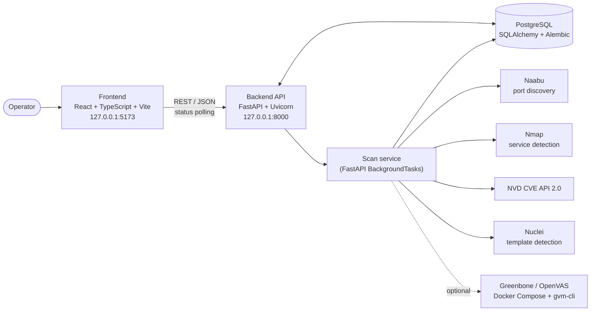
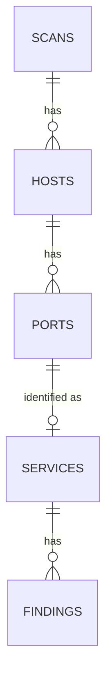
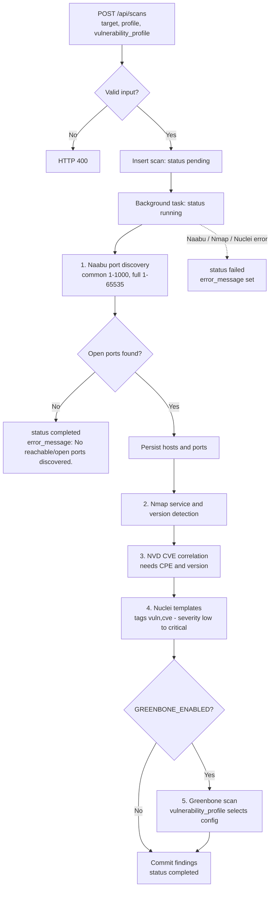

<div align="center">

# Zyncle Port Scanner

**Port discovery, service fingerprinting and CVE correlation in one scan workflow, with a SOC-style web dashboard.**


-0078D6)


[Overview](#overview) · [Features](#key-features) · [Architecture](#system-architecture) · [Setup](#installation-and-setup) · [API](#api-documentation) · [Testing](#testing-and-validation) · [Security](#security-considerations)

</div>

> **Authorized use only.** This tool actively scans networks and hosts. Scan only systems you own or have explicit written permission to assess. See [Security considerations](#security-considerations).

---

## Overview

Zyncle Port Scanner is a web application that orchestrates established open-source scanners behind a single REST API. For a given target it:

1. discovers open ports (**Naabu**),
2. identifies services and versions (**Nmap**),
3. correlates detected versions with published CVEs (**NVD API**),
4. runs template-based checks (**Nuclei**),
5. optionally adds a **Greenbone/OpenVAS** assessment.

Results are normalized, risk-classified, stored in PostgreSQL and explored through a React dashboard. The project orchestrates existing tools; it does not implement its own scanning engine.

Prepared as an internship project submission.

## Problem statement and objectives

Port discovery, service detection and vulnerability checks are usually run as separate tools with different output formats, which makes results hard to compare and track over time.

**Objectives**

- Run the tools as one repeatable workflow behind a simple API.
- Normalize output into a single, persisted data model (scan → host → port → service → finding).
- Apply a consistent, explainable risk classification.
- Present results in a dashboard with history and export.

## Key features

- 🔎 **Two port profiles**: `common` (ports 1–1000) and `full` (1–65535).
- 🧩 **Service and version detection** with CPE extraction (Nmap `-sV`).
- 🛡️ **NVD correlation**: CPE and version are matched to CVEs with version-range applicability filtering; CVSS score, CWE IDs and CVSS vector are stored.
- 🧪 **Nuclei template detection** (tags `vuln,cve`, severities low to critical).
- 🔌 **Optional Greenbone/OpenVAS integration** (disabled by default).
- ⚖️ **Deterministic risk classification** (CVSS thresholds) with the reason stored per finding.
- 🗄️ **Persistent history** in PostgreSQL, managed with Alembic migrations.
- 📊 **Dashboard** with seven views, live status polling (every 3 s), severity filtering, history filtering and **JSON / CSV / print-to-PDF export**.

## Application screenshots

| View | Shows |
|---|---|
| Dashboard | Summary of recent scans (totals, open ports, findings) |
| New Scan | Target, port profile, vulnerability profile |
| Current Scan | Live status, scan pipeline, results |
| Scan History | Past scans, filterable by status and profile |
| Vulnerabilities | Findings with severity distribution and filter |
| Assets | Hosts, open ports and services |
| Settings | API connection and scanner pipeline overview |

<!--
SCREENSHOT PLACEHOLDER
Add real, sanitized screenshots of the running application under docs/screenshots/
(no real targets, IP addresses, credentials or personal data), then reference them, e.g.:


Do not use mock or generated images.
-->

## Technology stack

| Layer | Technology |
|---|---|
| Frontend | React ^19.2, TypeScript ~6.0, Vite ^8.3, plain CSS (no UI framework); linting with oxlint |
| Backend | Python, FastAPI 0.142.2, Uvicorn 0.54.0, Pydantic 2.13.5, pydantic-settings 2.15.0 |
| Database | PostgreSQL, SQLAlchemy 2.1.3, psycopg 3.3.6, Alembic 1.20.0 |
| Scanners | Naabu (ports), Nmap (services), Nuclei (templates); versions are not pinned by the project |
| Intelligence | NVD CVE API 2.0 (HTTPS) |
| Optional | Greenbone/OpenVAS through Docker Compose and `gvm-cli` |

**UI design system.** Dark enterprise theme defined with CSS custom properties in `frontend/src/index.css` (background `#0a0f1a`, accent `#3b82f6`, dedicated critical/high/medium/low severity colors, system/Inter font stack with monospace for data). A light palette is applied for print/PDF export.

## System architecture



**Data model**



Findings carry a `source` of `nvd`, `nuclei` or `greenbone`.

## Scan workflow



Behavior worth knowing:

- Nuclei runs against the normalized target URL. Findings are stored only when their host and port match a discovered service.
- NVD lookup failures and Greenbone errors are logged and skipped; the scan still completes without those findings.
- A port inside the target (`host:8080`) does not change the Naabu range; it only affects the URL given to Nuclei.
- `vulnerability_profile` is stored for every scan but only influences Greenbone (`lightweight` = Base config, `full` = Full and Fast).

## Project directory structure

```text
.
├── README.md
├── start.ps1                    # Windows launcher (backend + frontend)
├── .gitignore
├── backend/
│   ├── requirements.txt
│   ├── alembic.ini
│   ├── .env                     # local only, never committed (git-ignored)
│   ├── app/
│   │   ├── main.py              # FastAPI app, CORS, /api/health
│   │   ├── api/scans.py         # /api/scans routes
│   │   ├── core/                # config.py (settings), database.py (engine/session)
│   │   ├── models/              # scan, host, port, service, finding
│   │   ├── services/scan_service.py   # scan pipeline orchestration
│   │   └── db_test.py           # database connectivity check
│   ├── migrations/              # Alembic environment + 10 revisions
│   ├── test_scan_service.py     # manual script, runs a real scan (not a pytest test)
│   └── test_nmap_integration.py # manual script, runs a real scan (not a pytest test)
├── scanner/
│   ├── target.py                # target normalization
│   ├── risk.py                  # risk classification
│   ├── adapters/                # naabu.py, nmap.py, nuclei.py, greenbone/client.py
│   └── intelligence/            # cpe_mapper.py, cve_client.py, cve_applicability.py
├── frontend/
│   ├── package.json / package-lock.json / vite.config.ts / tsconfig*.json
│   ├── public/
│   └── src/                     # main.tsx, App.tsx, api.ts, types.ts, utils.ts,
│                                # index.css, App.css, pages/ (7), components/ (16), assets/
├── tests/
│   └── test_cve_applicability.py
└── docs/
    └── screenshots/             # not created yet; add sanitized screenshots here
```

## Prerequisites

| Requirement | Notes |
|---|---|
| Windows 10/11 with Windows PowerShell | `start.ps1` launches `powershell` windows |
| Git | To clone the repository |
| Python 3.12+ | Pinned dependencies install on 3.12 |
| Node.js `^20.19` or `>=22.12` and npm | Required by Vite 8 |
| PostgreSQL | Version is not pinned by the project; migrations were verified on 16 |
| Naabu, Nmap, Nuclei | On `PATH` or configured by path, see [scanner tools](#naabu-nmap-and-nuclei) |
| Internet access | NVD lookups and Nuclei templates |
| Docker Desktop (optional) | Only for Greenbone |

## Installation and setup

Run all commands from the repository root in PowerShell.

### 1. Clone

```powershell
git clone <YOUR_GITHUB_REPOSITORY_URL>
cd <repository-folder>
```

### 2. Backend dependencies

```powershell
python -m venv backend\.venv
backend\.venv\Scripts\python.exe -m pip install --upgrade pip
backend\.venv\Scripts\python.exe -m pip install -r backend\requirements.txt
```

`start.ps1` expects the interpreter at `backend\.venv\Scripts\python.exe`.

### 3. Frontend dependencies

```powershell
npm --prefix frontend ci
```

`start.ps1` stops with an error if `frontend\node_modules` is missing.

### PostgreSQL configuration

Create a database and an owner role (names are examples). Run as a PostgreSQL superuser, e.g. `psql -U postgres`:

```sql
CREATE ROLE zyncle_app WITH LOGIN PASSWORD '<STRONG_UNIQUE_PASSWORD>';
CREATE DATABASE zyncle_scanner OWNER zyncle_app;
```

The application never creates tables itself; the schema exists only after you [apply the migrations](#database-migrations).

**Least privilege.** Alembic needs DDL rights, but the running API does not. Keep a DML-only role in `backend\.env` and run migrations with the owner role by setting `DATABASE_URL` for that one PowerShell session (environment variables override `.env`):

```sql
-- run as the owner, connected to zyncle_scanner, after migrations
CREATE ROLE zyncle_rw WITH LOGIN PASSWORD '<STRONG_UNIQUE_PASSWORD>';
GRANT CONNECT ON DATABASE zyncle_scanner TO zyncle_rw;
GRANT USAGE ON SCHEMA public TO zyncle_rw;
GRANT SELECT, INSERT, UPDATE ON scans, hosts, ports, services, findings TO zyncle_rw;
GRANT USAGE, SELECT ON ALL SEQUENCES IN SCHEMA public TO zyncle_rw;
```

### Environment variable reference

Create `backend\.env` (it is git-ignored). The backend loads it by absolute path (`backend/.env`, resolved from `backend/app/core/config.py`), so the working directory does not matter. Real environment variables take precedence over `.env`. Never commit the file and never paste real values into issues or screenshots.

```dotenv
# Required
DATABASE_URL=postgresql+psycopg://zyncle_app:<DB_PASSWORD>@localhost:5432/zyncle_scanner

# Optional: scanner executable paths (otherwise resolved from PATH)
# NAABU_PATH=C:/path/to/naabu.exe
# NUCLEI_PATH=C:/path/to/nuclei.exe
# NMAP_PATH=C:/path/to/nmap.exe

# Optional: Greenbone (disabled by default)
# GREENBONE_ENABLED=true
# GREENBONE_COMPOSE_DIR=C:/path/to/greenbone-compose
# GREENBONE_USERNAME=<GVM_USERNAME>
# GREENBONE_PASSWORD=<GVM_PASSWORD>
```

| Variable | Required | Default | Purpose |
|---|---|---|---|
| `DATABASE_URL` | Yes | none | SQLAlchemy URL. Use `postgresql+psycopg://`. URL-encode special characters in the password. |
| `NAABU_PATH`, `NMAP_PATH`, `NUCLEI_PATH` | No | resolved from `PATH` | Executable overrides. A path that does not exist is an error. |
| `GREENBONE_ENABLED` | No | `false` | Enables the Greenbone stage. |
| `GREENBONE_COMPOSE_DIR` | If enabled | empty | Directory containing the Greenbone compose file. |
| `GREENBONE_COMPOSE_FILE` | No | `compose.yaml` | Compose file name. |
| `GREENBONE_COMPOSE_SERVICE` | No | `gvm-tools` | Compose service that provides `gvm-cli`. |
| `GREENBONE_SOCKET` | No | `/run/gvmd/gvmd.sock` | gvmd socket path inside the container. |
| `GREENBONE_USERNAME` / `GREENBONE_PASSWORD` | If enabled | `admin` / empty | GMP credentials. |
| `GREENBONE_CONFIG_ID` | No | built-in Base config | Config used by the `lightweight` profile. |
| `GREENBONE_SCANNER_ID`, `GREENBONE_PORT_LIST_ID` | No | built-in defaults | Override if your instance differs. |
| `GREENBONE_TIMEOUT_SECONDS` / `GREENBONE_POLL_SECONDS` | No | `7200` / `5` | Scan timeout and polling interval. |
| `GREENBONE_LIGHTWEIGHT_CONFIG_ID`, `GREENBONE_FULL_CONFIG_ID` | No | empty | Declared in settings but **not currently read** by the adapter. |

**Set these as real environment variables, not in `.env`.** They are read with `os.getenv`, and `.env` values are not exported to the process environment:

| Variable | Default | Purpose |
|---|---|---|
| `NVD_API_KEY` | unset | Optional NVD API key (higher rate limits). |
| `NUCLEI_PROCESS_TIMEOUT` | `900` | Nuclei process timeout in seconds. |

```powershell
$env:NVD_API_KEY = "<YOUR_NVD_API_KEY>"   # then start the app from this same session
```

**Windows paths in `.env`:** use forward slashes, or unquoted/single-quoted values. Double-quoted values interpret backslash escapes (`"C:\tools\naabu.exe"` is corrupted).

### Naabu, Nmap and Nuclei

Install the tools from their official sources and make sure they run from PowerShell:

- Naabu: <https://github.com/projectdiscovery/naabu>
- Nuclei: <https://github.com/projectdiscovery/nuclei>
- Nmap: <https://nmap.org/download.html>

```powershell
naabu -version
nmap --version
nuclei -version
nuclei -update-templates      # the adapter disables update checks, so install templates yourself
```

> **The backend resolves all three executables when it starts.** If any is missing, the API fails to start (including `/api/health`), not just scans.

How the adapters invoke them (tuning values are hard-coded in `scanner/adapters/`):

| Tool | Invocation |
|---|---|
| Naabu | `-host <host> -p 1-1000\|1-65535 -c 100 -rate 3000 -timeout 1000 -retries 1 -json -silent -duc` (no scan-type flag; Naabu's default applies) |
| Nmap | `-sV --version-light -Pn -T4 -p <discovered ports> -oX -`, 120 s timeout per host |
| Nuclei | `-target <url> -jsonl -silent -timeout 5 -retries 0 -c 25 -rl 100 -bs 25 -no-interactsh -disable-update-check -tags vuln,cve -severity low,medium,high,critical` |

Naabu and Nuclei defaults are fast and can be noisy. Review them before scanning anything sensitive.

### Optional: Greenbone setup

Greenbone is disabled by default and this repository does not ship a Greenbone deployment. To use it:

1. Run Greenbone Community Edition under Docker Compose following Greenbone's official documentation, with a `gvm-tools` service that can reach the gvmd socket.
2. Start Docker Desktop and confirm `docker compose version` works.
3. Set `GREENBONE_ENABLED=true`, `GREENBONE_COMPOSE_DIR`, and the credentials in `backend\.env`.

The adapter runs `docker compose -f <file> run --rm -T ... gvm-cli socket ...` and passes credentials through a temporary config file mounted read-only, not on the command line. Built-in default IDs are used for the Base config (`lightweight`) and Full and Fast config (`full`).

### Database migrations

> **Applying migrations changes the database schema.** Review them and back up any data you care about first.

```powershell
cd backend
.\.venv\Scripts\python.exe -m alembic heads            # expected: 28b118ae6d18 (head)
.\.venv\Scripts\python.exe -m alembic current          # applied revision (none on a fresh DB)
.\.venv\Scripts\python.exe -m alembic upgrade head --sql   # prints SQL only, no DB changes
pg_dump -U zyncle_app -h localhost -d zyncle_scanner -F c -f <BACKUP_FILE_OUTSIDE_REPO>
.\.venv\Scripts\python.exe -m alembic upgrade head     # applies the schema
```

- The revision chain is linear (10 revisions). The last two add `profile` and `vulnerability_profile` to `scans` and backfill existing rows (`common`, `lightweight`).
- `downgrade` paths drop columns and tables and **delete data**; avoid them on databases that hold results.
- Alembic reads `DATABASE_URL` through `app.core.config`; the URL in `alembic.ini` is a placeholder.

Optional connectivity check:

```powershell
.\.venv\Scripts\python.exe -m app.db_test      # prints "Database connection successful: 1"
```

## Running the application

```powershell
.\start.ps1
```

If PowerShell blocks the script: `powershell -ExecutionPolicy Bypass -File .\start.ps1`.

`start.ps1` verifies that the virtual environment and `frontend\node_modules` exist, then opens two PowerShell windows:

| Service | Command (equivalent) | URL |
|---|---|---|
| Backend | `python -m uvicorn app.main:app --app-dir <repo-root> --reload --host 127.0.0.1 --port 8000` (from `backend/`) | <http://127.0.0.1:8000> |
| Frontend | `npm run dev -- --host 127.0.0.1` (from `frontend/`) | <http://127.0.0.1:5173> (check the Vite window if the port differs) |

It does **not** check `.env`, PostgreSQL, scanner tools or migrations. `app` is imported from the working directory (`backend/`) and the top-level `scanner/` package from `--app-dir` (the repository root). The paths are interpolated into single-quoted PowerShell strings, so a repository path containing an apostrophe will break the launcher.

> The launcher behavior above is taken from reading `start.ps1`. See [Testing and validation](#testing-and-validation) for what has actually been executed.

| Resource | URL |
|---|---|
| Swagger UI | <http://127.0.0.1:8000/docs> |
| ReDoc | <http://127.0.0.1:8000/redoc> |
| Health check | <http://127.0.0.1:8000/api/health> |

A production build (`npm --prefix frontend run build`) writes to `frontend/dist`. CORS allows only the two dev origins (`localhost:5173`, `127.0.0.1:5173`) in `backend/app/main.py`, and the API address is hard-coded in `frontend/src/api.ts`; change both if you serve the frontend elsewhere.

## API documentation

Routes extracted from `backend/app/main.py` and `backend/app/api/scans.py`; the frontend (`frontend/src/api.ts`) calls only the three `/api/scans` routes. There is no update or delete route. All responses are JSON.

| Method | Path | Description |
|---|---|---|
| `GET` | `/api/health` | `{"status": "ok", "service": "zyncle-port-scanner"}` (not called by the bundled frontend) |
| `POST` | `/api/scans` | Create a scan and start it in the background |
| `GET` | `/api/scans` | Latest 50 scans, newest first, with counts |
| `GET` | `/api/scans/{scan_id}` | Full scan detail |

### `POST /api/scans`

| Field | Type | Default | Allowed values |
|---|---|---|---|
| `target` | string (required) | none | Hostname or IP, optionally with scheme and port. A single host; ranges and CIDR are not supported. |
| `profile` | string | `common` | `common`, `full` |
| `vulnerability_profile` | string | `lightweight` | `lightweight`, `full` |

Values are trimmed and case-insensitive. Returns `200` with `id`, `target` (normalized to a URL), `profile`, `vulnerability_profile`, `status` (`pending`), `started_at` and `completed_at`. Both timestamps are `null` in this response: `started_at` is set when the background task begins and `completed_at` when it ends. Errors: `400` with a `detail` message (invalid profile or target), `422` for a malformed body.

```powershell
Invoke-RestMethod -Method Post -Uri http://127.0.0.1:8000/api/scans `
  -ContentType 'application/json' `
  -Body '{"target":"<AUTHORIZED_TARGET>","profile":"common","vulnerability_profile":"lightweight"}'
```

### `GET /api/scans`

Each item: `id`, `target`, `profile`, `vulnerability_profile`, `status`, `started_at`, `completed_at`, `error_message`, and the counts `hosts`, `open_ports`, `services`, `findings`.

### `GET /api/scans/{scan_id}`

Scan fields as above (without the counts), plus `hosts[]`:

- host: `id`, `address`, `hostname`, `status`, `ports[]`. The pipeline stores `status` as `up` and does not populate `hostname`, so it is currently always `null`.
- port: `id`, `port_number`, `protocol`, `state`, `service` (or `null`), `findings[]`. Findings are attached to the port's service, so a port without a detected service has an empty list.
- `service`: `id`, `service_name`, `product`, `version`, `cpe`, `confidence`, `banner`.
- finding: `id`, `title`, `description`, `vulnerability_id`, `severity`, `cvss_score`, `cwe_ids` (comma-separated string), `cvss_metrics`, `risk_level`, `risk_reason`, `source`, `matcher_name`, `evidence`, `detected_at`.

Returns `404` (`"Scan not found"`) for an unknown id.

**Scan status values:** `pending` → `running` → `completed` or `failed`. A completed scan with no open ports carries `error_message: "No reachable/open ports discovered."`.

## Testing and validation

Results are split into what was re-checked while auditing this documentation (2026-10-11, Linux, Python 3.12.3, Node 22.22, no network access) and results reported earlier that were **not** re-run. The audit environment had no PostgreSQL, no Naabu/Nmap/Nuclei and no installed backend dependencies, and the copied `frontend/node_modules` contained only Windows native bindings.

**Re-checked during the audit**

| Check | Status |
|---|---|
| `tests/test_cve_applicability.py` collects | ❌ `SyntaxError` at line 134 (`cve,s`) |
| The same 7 tests with line 134 corrected in a temporary copy (repository file untouched) | ✅ 7 of 7 passed |
| `tsc -b` (type-check step of `npm run build`) | ✅ finished without errors |
| Alembic revision chain, read from the `down_revision` values | ✅ one linear chain of 10 revisions, head `28b118ae6d18` |
| Vite bundling and `npm run lint` (oxlint) | ⬜ could not run here (Windows-only native bindings) |

**Reported earlier by the author, not re-run**

| Check | Reported result |
|---|---|
| `npm --prefix frontend run build` | Passed |
| `npm --prefix frontend run lint` | 0 errors, 1 warning (`react/set-state-in-effect` in `App.tsx`) |
| `pip install -r backend/requirements.txt` | Passed |
| Alembic `upgrade head` and `alembic check` | No drift detected |
| API smoke test with stub scanners (all routes, 400/404/422, CORS, failure and no-open-ports paths) | Passed |
| Full API flow with a DML-only database role | Passed |

**Not verified:** real Naabu, Nmap and Nuclei runs, live NVD lookups, Greenbone, `start.ps1` on Windows, Python 3.14 and PostgreSQL versions other than 16. **Do not exist:** frontend unit/e2e tests, API tests and CI.

<!-- AUTHOR TODO: after fixing tests/test_cve_applicability.py line 134, change the first row to "✅ 7 passed" and re-run the earlier-reported checks to refresh this section. -->

```powershell
backend\.venv\Scripts\python.exe -m pip install pytest
backend\.venv\Scripts\python.exe -m pytest tests -v
npm --prefix frontend run build
npm --prefix frontend run lint
```

> Always pass `tests` to pytest. `backend/test_scan_service.py` and `backend/test_nmap_integration.py` are manual scripts, not tests: they run a real scan of `127.0.0.1` at import time and start with a `sys.path.insert(...)` line containing a hard-coded Windows path that you must edit before use. They must not be collected by pytest.

## Troubleshooting

| Symptom | Likely cause and fix |
|---|---|
| Backend exits at startup with `naabu/nmap/nuclei was not found` | Executable missing from `PATH`. Install it or set `NAABU_PATH` / `NMAP_PATH` / `NUCLEI_PATH`. |
| `database_url Field required` | `backend\.env` missing or has no `DATABASE_URL`. |
| `relation "scans" does not exist` | Migrations not applied. |
| Connection or authentication errors | PostgreSQL not running, or wrong credentials or database name. |
| `start.ps1` reports a missing virtual environment or dependencies | Repeat [steps 2 and 3](#2-backend-dependencies). |
| `start.ps1` is blocked | PowerShell execution policy; see [Running the application](#running-the-application). |
| Dashboard shows "API unreachable" | Backend not running, or Vite is on a port other than 5173 (CORS only allows 5173). |
| Scan stays `pending` or `running` | Backend restarted mid-scan (scans run in-process and are not recovered), or a long `full` profile. Limits: Nmap 120 s per host, Nuclei 900 s by default, Greenbone 7200 s. Naabu has no process timeout. |
| Scan `failed` | Read `error_message` and the backend window. Typical causes are a tool exiting non-zero or timing out. |
| No findings | NVD correlation needs both a CPE and a version from Nmap; Nuclei needs templates installed; Greenbone is off by default. |
| `NVD_API_KEY` or `NUCLEI_PROCESS_TIMEOUT` has no effect | They must be real environment variables, not `.env` entries. |
| `npm run build` or `npm run lint` fails with "Permission denied" or a missing native binding | `node_modules` was copied from another operating system. Delete `frontend/node_modules` and run `npm --prefix frontend ci` on the machine that will build. |

## Security considerations

**Authorization.** Obtain explicit written permission before scanning any system you do not own. Unauthorized scanning may be illegal.

| Area | Guidance |
|---|---|
| Secrets | Keep `backend\.env` out of Git; never commit credentials, API keys or private connection URLs. `.gitignore` excludes `.env`, `.env.*`, `.venv/`, `node_modules/`, `dist/`, `__pycache__/` and `*.log`. |
| Database | Use the least-privilege role described above; use a unique strong password. |
| Access control | **The API has no authentication or authorization.** Anyone who can reach port 8000 can launch scans against arbitrary targets and read every stored result. Keep it bound to `127.0.0.1` and do not expose it to a network. CORS is not access control. |
| Target scope | Input is only checked for a valid hostname. There is no allow-list or private-range restriction, so enforce scope yourself. |
| Scan results | Banners, versions and findings are stored in plaintext and exported by the UI as `zyncle-scan-<id>.json/.csv` into the browser's download folder. Treat both as sensitive. |
| Error output | A failed scan's `error_message` is stored and returned by the API; for example a Naabu failure includes the full command line and local executable path, and Nmap/Nuclei failures include the tool's stderr. The Nmap command line is also printed to the backend console. |
| Scanner behavior | Naabu and Nuclei rate/concurrency are hard-coded and aggressive. Nuclei runs with Interactsh disabled; detected product/version strings (CPE) are sent to the NVD API. |
| Migrations | Review the SQL and back up data before applying; avoid downgrades on real data. |

## Known limitations

- Single-target scans only; no CIDR, ranges or target lists. Port discovery uses Naabu's default scan type; UDP is not configured.
- No authentication, users, queue, scan cancellation or recovery of interrupted scans. Scans run in-process via `BackgroundTasks`.
- History returns only the latest 50 scans, without pagination.
- The API reports overall status only, so the UI cannot show per-stage progress.
- `vulnerability_profile` affects only Greenbone; findings are stored only when matched to a discovered service.
- Tool tuning is hard-coded; only the executable paths and the Nuclei timeout are configurable. The Naabu process has no timeout.
- Frontend uses state-based navigation (no URL routing); API address and CORS origins are fixed to local development values.
- `start.ps1` is Windows-only and breaks on repository paths containing an apostrophe. No Dockerfile, CI, or Linux/macOS launcher is provided.
- The two manual scripts in `backend/` contain a hard-coded local path and run real scans when imported.
- Test coverage is limited to one unit-test module (CVE version applicability); there are no API or frontend tests.

## Future improvements

Proposals, not implemented features:

- Authentication and a configurable target allow-list.
- Per-stage progress reporting, scan cancellation and recovery of interrupted scans.
- Configurable scan tuning (rate, concurrency, timeouts) and a configurable API base URL for the frontend.
- Pagination for history; server-side report export.
- API and frontend tests, plus CI.
- Cross-platform launch scripts and containerization.

## Contributing

No formal contribution process has been defined. To propose a change, open an issue first. Before submitting, run the [validation commands](#testing-and-validation), keep migrations reviewed, and never commit secrets.

## License

No license file is currently included. Until the author adds one, default copyright applies and others have no permission to use, modify or redistribute the code.

## Author

Fajle Imam. Developed as an internship project submission.
